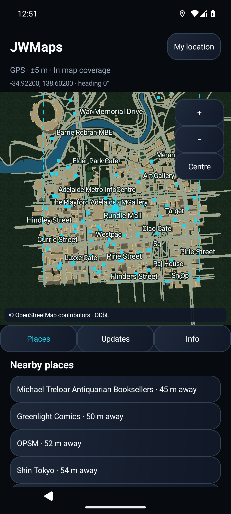

# Verification for JWMaps 0.1.1

These checks describe the published preview, not a claim of production navigation or Ford compatibility.

## Automated checks

The local run covered 31 distinct automated tests: 19 Java/Android tests and 12 Python publisher/map-tool tests. Across debug, standalone release and Play variants, there were 50 passing executions and one intentional skip. The skipped scenario tests standalone APK staging and does not apply to the Play build, where that path is disabled.

| Test group | Cases | Failures/errors | Skipped |
| --- | ---: | ---: | ---: |
| Java update/map core | 8 | 0 | 0 |
| Android debug | 10 | 0 | 0 |
| Android standalone release | 10 | 0 | 0 |
| Android Play build | 11 | 0 | 1 |
| Python map/publisher tools | 12 | 0 | 0 |

Checks include strict signed manifests, malformed/duplicate JSON, URL/redirect restrictions, hash/size limits, rollback refusal, preservation of known-good maps, data-only releases, APK identity/current-signer rejection, location lifecycle, phone/car template construction, visible-map rendering and removal of Play's external-install permission.

A regression test also proves that a valid map remains committed if APK staging fails. The next attempt retries only the APK, and the UI reports the partial success honestly.

Lint passed for debug, release and Play variants. Both standalone APK and Play bundle builds completed. [GitHub CI passed for the release source](https://github.com/wallajl/JWMaps/actions/runs/40873372883).

## Actual Android emulator exercise

The signed APK was installed and launched in an API 35 Android emulator using Android Emulator 36.6.11. The following actions were exercised through the actual app and Android UI:

1. Opened the bundled Adelaide preview without location permission.
2. Granted location through Android's permission sheet. Simulated an Adelaide position and then an out-of-coverage position, verifying the different map/nearby-place messages.
3. From QA app 0.1.0, checked the real public GitHub release. The app verified and downloaded map revision 2 and staged APK 0.1.1.
4. Granted per-source installation permission and approved the update in Android's system package installer.
5. Opened the updated app. Its Updates screen showed **JWMaps 0.1.1**, **Adelaide city centre v2**, and **App and map pack are current.**

The Android installer, not `adb install`, performed the 0.1.0-to-0.1.1 upgrade. ADB was used to install the initial QA baseline and to drive this isolated emulator test.

The screenshot is from an Android emulator with simulated GPS. It is not a Samsung or Ford screen capture.

## Release integrity and dependency checks

- Android `apksigner` verification passed. The released APK's signing identity matches the QA baseline, and package/version metadata was independently inspected.
- The actual APK targets API 36. The standalone APK requests external-package-install permission; the Play APK does not.
- The published manifest was verified with the app core's pinned public key, independently of the Python signer. The expanded map parsed as 3,318 genuine OSM-derived features.
- All six published release assets were downloaded anonymously and matched the local release bytes exactly. The release includes `SHA256SUMS`.
- The resolved release runtime graph was checked against OSV: 48 modules and zero known-advisory matches at the time checked. An earlier Guava advisory was addressed by using 33.7.2-android. This lookup does not prove dependencies are vulnerability-free.

## Not yet verified or implemented

- Samsung hardware and real GPS reception have not been tested. Emulator positions were simulated.
- No Ford/SYNC or Desktop Head Unit test was performed. Car App Library sessions, templates, host validation and map rendering were tested separately. Trusted Play distribution and a parked vehicle test remain necessary.
- Route calculation, turn-by-turn directions, Waze data and worldwide coverage are not part of this preview.
